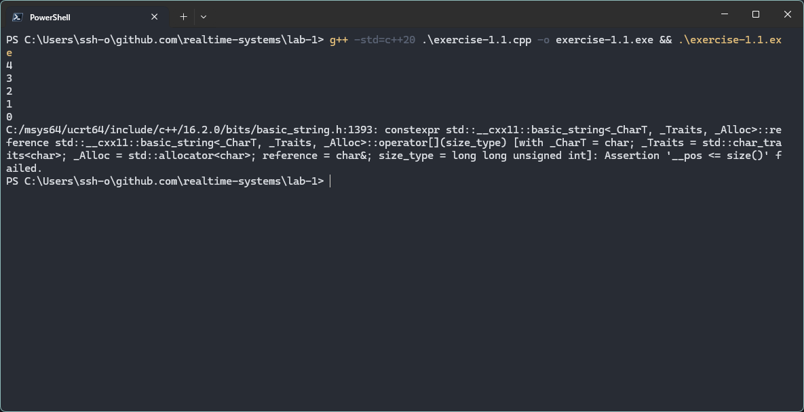
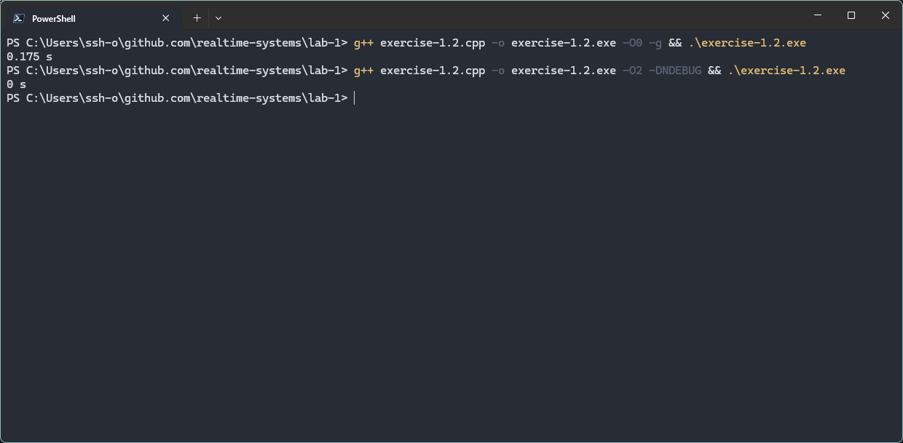
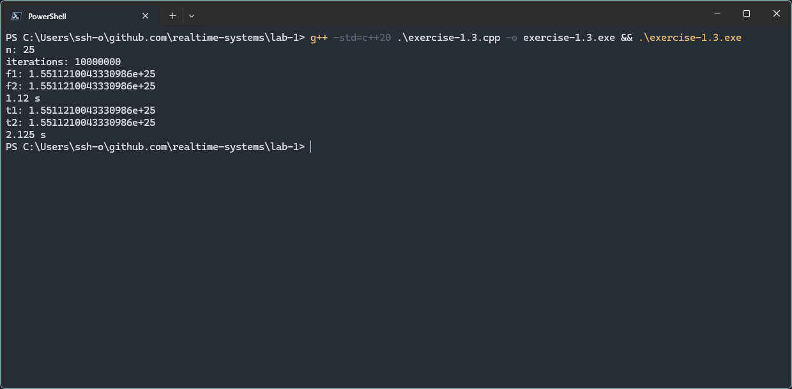

# Отчёт

## Пункт 1.1
Вывод символов строки в обратном порядке, каждый символ с новой строки. После вывода 5-ти символов - ошибка, что-то вроде "out of range"
Так как мы делаем "i" - unsigned, условие i >= 0 - всегда true, unsigned 0 - 1 = очень большое число(4294967295)

## Пункт 1.2
_Debug_: g++ exercise-1.2.cpp -o exercise-1.2.exe -O0 -g  && .\exercise-1.2.exe (0.175 s)

_Release_: g++ exercise-1.2.cpp -o exercise-1.2.exe -O2 -DNDEBUG  && .\exercise-1.2.exe (0 s)

_Debug_ сборка выключает некоторые оптимизации во время компиляции кода и добавляет отладочную информацию. В _Release_ сборке оптимизации включены, так как вычисляемое значение не используется во все, то компилятор убирает его вычисление. Полученное значение 0 с. означает, что таймер не зарегистрировал различие между начальным и конечным отсчётами.

## Пункт 1.3

Запуск двух параллельных потоков - 1.12 с.
Запуск последовательно - 2.125 с.
Разница в секунду обусловлена одновременным исполниенем функций.