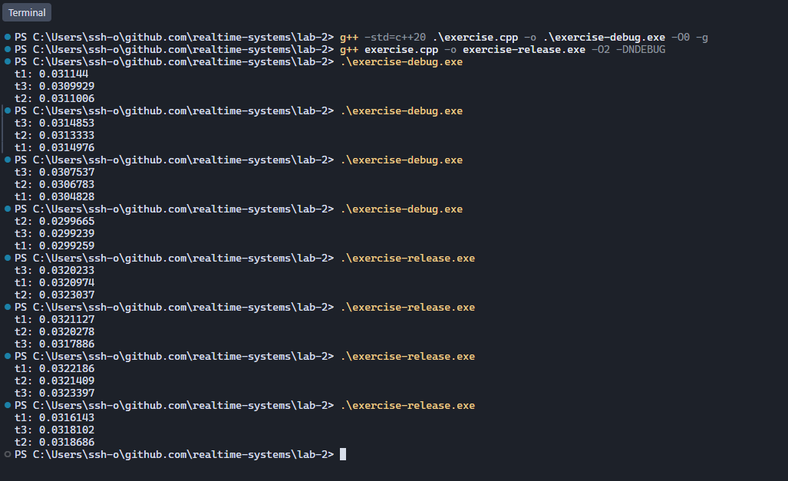
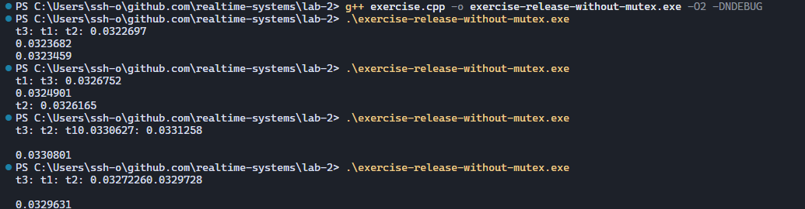

# Отчёт 

_Сборка Debug_ : g++ -std=c++20 .\exercise.cpp -o .\exercise-debug.exe -O0 -g

_Сборка Release_ : g++ exercise.cpp -o exercise-release.exe -O2 -DNDEBUG

1. Значения рознятся от запуска к запуску, при этом Release сборка выдаёт значения немного больше чем Debug. Разница запусков и потоков и колеблится в диапозоне примерно +-0.001
2. Для замера времени засекается начальный момент времени и в цикле проверяется и обновлениятся второй момент времени "now", цикл работает пока разница между двумя моментами времени не достигнет значения в >=1 секунду. Каждую итерацию цикла к значению переменной i добавляется 1e-9. После того как цикл остановился значение i равно количеству итераций N * 1е-9 произошедших за примерно 1 секунду процессорного времени. N - кол-во моментов когда процессорм был занят именно этим потоком.
3. Число итераций N зависит от того сколько процессорного времени получил поток, на это влияют планировщик ОС, фоновые программы, переключение потоков и изменение частоты процессора. К тому же сама проверка времени и получение текущего момента времени занимает время. В Release замечено увелечение кол-во итераций, это происходит из-за оптимизаций которые включает эта сборка, цикл выполняется быстрее.

4. Запуск без мьютекса ломает вывод, три потока пытаются записать информацию в один stdout.
