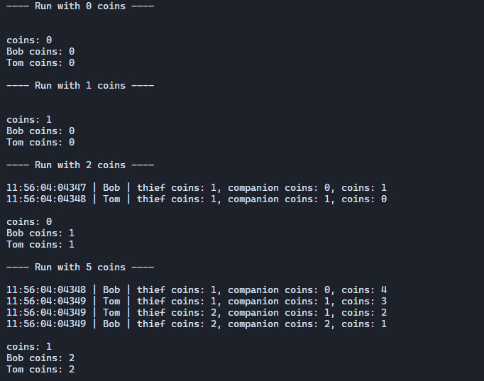

# Отчёт

## Запуск программы:



```
---- Run with 100 coins ----

11:56:04:04349 | Bob | thief coins: 1, companion coins: 0, coins: 99
11:56:04:04349 | Tom | thief coins: 1, companion coins: 1, coins: 98
11:56:04:04349 | Tom | thief coins: 2, companion coins: 1, coins: 97
11:56:04:04349 | Bob | thief coins: 2, companion coins: 2, coins: 96
11:56:04:04349 | Bob | thief coins: 3, companion coins: 2, coins: 95
11:56:04:04349 | Tom | thief coins: 3, companion coins: 3, coins: 94
11:56:04:04349 | Tom | thief coins: 4, companion coins: 3, coins: 93
11:56:04:04349 | Bob | thief coins: 4, companion coins: 4, coins: 92
11:56:04:04349 | Bob | thief coins: 5, companion coins: 4, coins: 91
11:56:04:04349 | Tom | thief coins: 5, companion coins: 5, coins: 90
11:56:04:04349 | Tom | thief coins: 6, companion coins: 5, coins: 89
11:56:04:04349 | Bob | thief coins: 6, companion coins: 6, coins: 88
11:56:04:04349 | Bob | thief coins: 7, companion coins: 6, coins: 87
11:56:04:04349 | Tom | thief coins: 7, companion coins: 7, coins: 86
11:56:04:04349 | Tom | thief coins: 8, companion coins: 7, coins: 85
11:56:04:04349 | Bob | thief coins: 8, companion coins: 8, coins: 84
11:56:04:04350 | Bob | thief coins: 9, companion coins: 8, coins: 83
11:56:04:04350 | Tom | thief coins: 9, companion coins: 9, coins: 82
11:56:04:04350 | Tom | thief coins: 10, companion coins: 9, coins: 81
11:56:04:04350 | Bob | thief coins: 10, companion coins: 10, coins: 80
11:56:04:04350 | Bob | thief coins: 11, companion coins: 10, coins: 79
11:56:04:04350 | Tom | thief coins: 11, companion coins: 11, coins: 78
11:56:04:04350 | Tom | thief coins: 12, companion coins: 11, coins: 77
11:56:04:04350 | Bob | thief coins: 12, companion coins: 12, coins: 76
11:56:04:04350 | Bob | thief coins: 13, companion coins: 12, coins: 75
11:56:04:04350 | Tom | thief coins: 13, companion coins: 13, coins: 74
11:56:04:04350 | Tom | thief coins: 14, companion coins: 13, coins: 73
11:56:04:04350 | Bob | thief coins: 14, companion coins: 14, coins: 72
11:56:04:04350 | Bob | thief coins: 15, companion coins: 14, coins: 71
11:56:04:04350 | Tom | thief coins: 15, companion coins: 15, coins: 70
11:56:04:04350 | Tom | thief coins: 16, companion coins: 15, coins: 69
11:56:04:04350 | Bob | thief coins: 16, companion coins: 16, coins: 68
11:56:04:04350 | Bob | thief coins: 17, companion coins: 16, coins: 67
11:56:04:04350 | Tom | thief coins: 17, companion coins: 17, coins: 66
11:56:04:04350 | Tom | thief coins: 18, companion coins: 17, coins: 65
11:56:04:04350 | Bob | thief coins: 18, companion coins: 18, coins: 64
11:56:04:04350 | Bob | thief coins: 19, companion coins: 18, coins: 63
11:56:04:04350 | Tom | thief coins: 19, companion coins: 19, coins: 62
11:56:04:04350 | Tom | thief coins: 20, companion coins: 19, coins: 61
11:56:04:04350 | Bob | thief coins: 20, companion coins: 20, coins: 60
11:56:04:04350 | Bob | thief coins: 21, companion coins: 20, coins: 59
11:56:04:04351 | Tom | thief coins: 21, companion coins: 21, coins: 58
11:56:04:04351 | Tom | thief coins: 22, companion coins: 21, coins: 57
11:56:04:04351 | Bob | thief coins: 22, companion coins: 22, coins: 56
11:56:04:04351 | Bob | thief coins: 23, companion coins: 22, coins: 55
11:56:04:04351 | Tom | thief coins: 23, companion coins: 23, coins: 54
11:56:04:04351 | Tom | thief coins: 24, companion coins: 23, coins: 53
11:56:04:04351 | Bob | thief coins: 24, companion coins: 24, coins: 52
11:56:04:04351 | Bob | thief coins: 25, companion coins: 24, coins: 51
11:56:04:04351 | Tom | thief coins: 25, companion coins: 25, coins: 50
11:56:04:04351 | Tom | thief coins: 26, companion coins: 25, coins: 49
11:56:04:04351 | Bob | thief coins: 26, companion coins: 26, coins: 48
11:56:04:04351 | Bob | thief coins: 27, companion coins: 26, coins: 47
11:56:04:04351 | Tom | thief coins: 27, companion coins: 27, coins: 46
11:56:04:04351 | Tom | thief coins: 28, companion coins: 27, coins: 45
11:56:04:04351 | Bob | thief coins: 28, companion coins: 28, coins: 44
11:56:04:04351 | Bob | thief coins: 29, companion coins: 28, coins: 43
11:56:04:04351 | Tom | thief coins: 29, companion coins: 29, coins: 42
11:56:04:04351 | Tom | thief coins: 30, companion coins: 29, coins: 41
11:56:04:04351 | Bob | thief coins: 30, companion coins: 30, coins: 40
11:56:04:04351 | Bob | thief coins: 31, companion coins: 30, coins: 39
11:56:04:04351 | Tom | thief coins: 31, companion coins: 31, coins: 38
11:56:04:04351 | Tom | thief coins: 32, companion coins: 31, coins: 37
11:56:04:04351 | Bob | thief coins: 32, companion coins: 32, coins: 36
11:56:04:04351 | Bob | thief coins: 33, companion coins: 32, coins: 35
11:56:04:04351 | Tom | thief coins: 33, companion coins: 33, coins: 34
11:56:04:04351 | Tom | thief coins: 34, companion coins: 33, coins: 33
11:56:04:04351 | Bob | thief coins: 34, companion coins: 34, coins: 32
11:56:04:04352 | Bob | thief coins: 35, companion coins: 34, coins: 31
11:56:04:04352 | Tom | thief coins: 35, companion coins: 35, coins: 30
11:56:04:04352 | Tom | thief coins: 36, companion coins: 35, coins: 29
11:56:04:04352 | Bob | thief coins: 36, companion coins: 36, coins: 28
11:56:04:04352 | Bob | thief coins: 37, companion coins: 36, coins: 27
11:56:04:04352 | Tom | thief coins: 37, companion coins: 37, coins: 26
11:56:04:04352 | Tom | thief coins: 38, companion coins: 37, coins: 25
11:56:04:04352 | Bob | thief coins: 38, companion coins: 38, coins: 24
11:56:04:04352 | Bob | thief coins: 39, companion coins: 38, coins: 23
11:56:04:04352 | Tom | thief coins: 39, companion coins: 39, coins: 22
11:56:04:04352 | Tom | thief coins: 40, companion coins: 39, coins: 21
11:56:04:04352 | Bob | thief coins: 40, companion coins: 40, coins: 20
11:56:04:04352 | Bob | thief coins: 41, companion coins: 40, coins: 19
11:56:04:04352 | Tom | thief coins: 41, companion coins: 41, coins: 18
11:56:04:04352 | Tom | thief coins: 42, companion coins: 41, coins: 17
11:56:04:04352 | Bob | thief coins: 42, companion coins: 42, coins: 16
11:56:04:04352 | Bob | thief coins: 43, companion coins: 42, coins: 15
11:56:04:04352 | Tom | thief coins: 43, companion coins: 43, coins: 14
11:56:04:04352 | Tom | thief coins: 44, companion coins: 43, coins: 13
11:56:04:04353 | Bob | thief coins: 44, companion coins: 44, coins: 12
11:56:04:04353 | Bob | thief coins: 45, companion coins: 44, coins: 11
11:56:04:04353 | Tom | thief coins: 45, companion coins: 45, coins: 10
11:56:04:04353 | Tom | thief coins: 46, companion coins: 45, coins: 9
11:56:04:04353 | Bob | thief coins: 46, companion coins: 46, coins: 8
11:56:04:04353 | Bob | thief coins: 47, companion coins: 46, coins: 7
11:56:04:04353 | Tom | thief coins: 47, companion coins: 47, coins: 6
11:56:04:04353 | Tom | thief coins: 48, companion coins: 47, coins: 5
11:56:04:04353 | Bob | thief coins: 48, companion coins: 48, coins: 4
11:56:04:04353 | Bob | thief coins: 49, companion coins: 48, coins: 3
11:56:04:04353 | Tom | thief coins: 49, companion coins: 49, coins: 2
11:56:04:04353 | Tom | thief coins: 50, companion coins: 49, coins: 1
11:56:04:04353 | Bob | thief coins: 50, companion coins: 50, coins: 0

coins: 0
Bob coins: 50
Tom coins: 50

---- Run with 101 coins ----

11:56:04:04354 | Bob | thief coins: 1, companion coins: 0, coins: 100
11:56:04:04354 | Tom | thief coins: 1, companion coins: 1, coins: 99
11:56:04:04354 | Tom | thief coins: 2, companion coins: 1, coins: 98
11:56:04:04354 | Bob | thief coins: 2, companion coins: 2, coins: 97
11:56:04:04354 | Bob | thief coins: 3, companion coins: 2, coins: 96
11:56:04:04354 | Tom | thief coins: 3, companion coins: 3, coins: 95
11:56:04:04354 | Tom | thief coins: 4, companion coins: 3, coins: 94
11:56:04:04354 | Bob | thief coins: 4, companion coins: 4, coins: 93
11:56:04:04354 | Bob | thief coins: 5, companion coins: 4, coins: 92
11:56:04:04354 | Tom | thief coins: 5, companion coins: 5, coins: 91
11:56:04:04354 | Tom | thief coins: 6, companion coins: 5, coins: 90
11:56:04:04355 | Bob | thief coins: 6, companion coins: 6, coins: 89
11:56:04:04355 | Bob | thief coins: 7, companion coins: 6, coins: 88
11:56:04:04355 | Tom | thief coins: 7, companion coins: 7, coins: 87
11:56:04:04355 | Tom | thief coins: 8, companion coins: 7, coins: 86
11:56:04:04355 | Bob | thief coins: 8, companion coins: 8, coins: 85
11:56:04:04355 | Bob | thief coins: 9, companion coins: 8, coins: 84
11:56:04:04355 | Tom | thief coins: 9, companion coins: 9, coins: 83
11:56:04:04355 | Tom | thief coins: 10, companion coins: 9, coins: 82
11:56:04:04355 | Bob | thief coins: 10, companion coins: 10, coins: 81
11:56:04:04355 | Bob | thief coins: 11, companion coins: 10, coins: 80
11:56:04:04355 | Tom | thief coins: 11, companion coins: 11, coins: 79
11:56:04:04355 | Tom | thief coins: 12, companion coins: 11, coins: 78
11:56:04:04355 | Bob | thief coins: 12, companion coins: 12, coins: 77
11:56:04:04355 | Bob | thief coins: 13, companion coins: 12, coins: 76
11:56:04:04355 | Tom | thief coins: 13, companion coins: 13, coins: 75
11:56:04:04355 | Tom | thief coins: 14, companion coins: 13, coins: 74
11:56:04:04355 | Bob | thief coins: 14, companion coins: 14, coins: 73
11:56:04:04355 | Bob | thief coins: 15, companion coins: 14, coins: 72
11:56:04:04355 | Tom | thief coins: 15, companion coins: 15, coins: 71
11:56:04:04356 | Tom | thief coins: 16, companion coins: 15, coins: 70
11:56:04:04356 | Bob | thief coins: 16, companion coins: 16, coins: 69
11:56:04:04356 | Bob | thief coins: 17, companion coins: 16, coins: 68
11:56:04:04356 | Tom | thief coins: 17, companion coins: 17, coins: 67
11:56:04:04356 | Tom | thief coins: 18, companion coins: 17, coins: 66
11:56:04:04356 | Bob | thief coins: 18, companion coins: 18, coins: 65
11:56:04:04356 | Bob | thief coins: 19, companion coins: 18, coins: 64
11:56:04:04356 | Tom | thief coins: 19, companion coins: 19, coins: 63
11:56:04:04356 | Tom | thief coins: 20, companion coins: 19, coins: 62
11:56:04:04356 | Bob | thief coins: 20, companion coins: 20, coins: 61
11:56:04:04356 | Bob | thief coins: 21, companion coins: 20, coins: 60
11:56:04:04356 | Tom | thief coins: 21, companion coins: 21, coins: 59
11:56:04:04356 | Tom | thief coins: 22, companion coins: 21, coins: 58
11:56:04:04356 | Bob | thief coins: 22, companion coins: 22, coins: 57
11:56:04:04356 | Bob | thief coins: 23, companion coins: 22, coins: 56
11:56:04:04356 | Tom | thief coins: 23, companion coins: 23, coins: 55
11:56:04:04356 | Tom | thief coins: 24, companion coins: 23, coins: 54
11:56:04:04356 | Bob | thief coins: 24, companion coins: 24, coins: 53
11:56:04:04356 | Bob | thief coins: 25, companion coins: 24, coins: 52
11:56:04:04356 | Tom | thief coins: 25, companion coins: 25, coins: 51
11:56:04:04357 | Tom | thief coins: 26, companion coins: 25, coins: 50
11:56:04:04357 | Bob | thief coins: 26, companion coins: 26, coins: 49
11:56:04:04357 | Bob | thief coins: 27, companion coins: 26, coins: 48
11:56:04:04357 | Tom | thief coins: 27, companion coins: 27, coins: 47
11:56:04:04357 | Tom | thief coins: 28, companion coins: 27, coins: 46
11:56:04:04357 | Bob | thief coins: 28, companion coins: 28, coins: 45
11:56:04:04357 | Bob | thief coins: 29, companion coins: 28, coins: 44
11:56:04:04357 | Tom | thief coins: 29, companion coins: 29, coins: 43
11:56:04:04357 | Tom | thief coins: 30, companion coins: 29, coins: 42
11:56:04:04357 | Bob | thief coins: 30, companion coins: 30, coins: 41
11:56:04:04357 | Bob | thief coins: 31, companion coins: 30, coins: 40
11:56:04:04357 | Tom | thief coins: 31, companion coins: 31, coins: 39
11:56:04:04357 | Tom | thief coins: 32, companion coins: 31, coins: 38
11:56:04:04357 | Bob | thief coins: 32, companion coins: 32, coins: 37
11:56:04:04357 | Bob | thief coins: 33, companion coins: 32, coins: 36
11:56:04:04357 | Tom | thief coins: 33, companion coins: 33, coins: 35
11:56:04:04357 | Tom | thief coins: 34, companion coins: 33, coins: 34
11:56:04:04357 | Bob | thief coins: 34, companion coins: 34, coins: 33
11:56:04:04357 | Bob | thief coins: 35, companion coins: 34, coins: 32
11:56:04:04357 | Tom | thief coins: 35, companion coins: 35, coins: 31
11:56:04:04357 | Tom | thief coins: 36, companion coins: 35, coins: 30
11:56:04:04358 | Bob | thief coins: 36, companion coins: 36, coins: 29
11:56:04:04358 | Bob | thief coins: 37, companion coins: 36, coins: 28
11:56:04:04358 | Tom | thief coins: 37, companion coins: 37, coins: 27
11:56:04:04358 | Tom | thief coins: 38, companion coins: 37, coins: 26
11:56:04:04358 | Bob | thief coins: 38, companion coins: 38, coins: 25
11:56:04:04358 | Bob | thief coins: 39, companion coins: 38, coins: 24
11:56:04:04358 | Tom | thief coins: 39, companion coins: 39, coins: 23
11:56:04:04358 | Tom | thief coins: 40, companion coins: 39, coins: 22
11:56:04:04358 | Bob | thief coins: 40, companion coins: 40, coins: 21
11:56:04:04358 | Bob | thief coins: 41, companion coins: 40, coins: 20
11:56:04:04358 | Tom | thief coins: 41, companion coins: 41, coins: 19
11:56:04:04358 | Tom | thief coins: 42, companion coins: 41, coins: 18
11:56:04:04358 | Bob | thief coins: 42, companion coins: 42, coins: 17
11:56:04:04358 | Bob | thief coins: 43, companion coins: 42, coins: 16
11:56:04:04358 | Tom | thief coins: 43, companion coins: 43, coins: 15
11:56:04:04358 | Tom | thief coins: 44, companion coins: 43, coins: 14
11:56:04:04358 | Bob | thief coins: 44, companion coins: 44, coins: 13
11:56:04:04358 | Bob | thief coins: 45, companion coins: 44, coins: 12
11:56:04:04358 | Tom | thief coins: 45, companion coins: 45, coins: 11
11:56:04:04358 | Tom | thief coins: 46, companion coins: 45, coins: 10
11:56:04:04358 | Bob | thief coins: 46, companion coins: 46, coins: 9
11:56:04:04358 | Bob | thief coins: 47, companion coins: 46, coins: 8
11:56:04:04358 | Tom | thief coins: 47, companion coins: 47, coins: 7
11:56:04:04359 | Tom | thief coins: 48, companion coins: 47, coins: 6
11:56:04:04359 | Bob | thief coins: 48, companion coins: 48, coins: 5
11:56:04:04359 | Bob | thief coins: 49, companion coins: 48, coins: 4
11:56:04:04359 | Tom | thief coins: 49, companion coins: 49, coins: 3
11:56:04:04359 | Tom | thief coins: 50, companion coins: 49, coins: 2
11:56:04:04359 | Bob | thief coins: 50, companion coins: 50, coins: 1

coins: 1
Bob coins: 50
Tom coins: 50
```